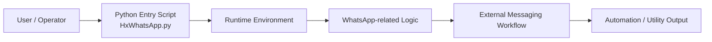

# HxWhatsApp

<div align="center">

[](https://www.python.org/)
[](https://github.com/Bl4ckDr460n/HxWhatsApp)
[](https://github.com/Bl4ckDr460n/HxWhatsApp)
[](https://github.com/Bl4ckDr460n/HxWhatsApp)

</div>

<p align="center">
  <a href="#overview">Overview</a> ·
  <a href="#features">Features</a> ·
  <a href="#architecture">Architecture</a> ·
  <a href="#getting-started">Getting started</a> ·
  <a href="#roadmap">Roadmap</a> ·
  <a href="#contributing">Contributing</a>
</p>

HxWhatsApp is a lightweight Python project focused on WhatsApp-related automation and utility scripting. The repository is intentionally minimal and centered around a single entry script, making it easy to study, run, and extend.

## Overview

This project currently contains a compact, single-file implementation designed for experimentation and local use. It serves as a practical foundation for building a more complete WhatsApp automation or messaging workflow tool.

## Architecture



This is a minimal architecture: a single entry point runs a local Python runtime, which executes the project logic and connects to the messaging workflow it is designed to automate.

## Why this project?

- Minimal setup and quick local execution
- Simple project structure for learning and prototyping
- Easy to extend with new features or integrations
- Suitable as a starting point for custom WhatsApp automation workflows

## Features at a glance

| Area | Current state | Value |
| --- | --- | --- |
| Project size | Small and focused | Easy to understand and maintain |
| Setup | Simple Python workflow | Quick start for local experimentation |
| Entry point | Single script | Minimal dependencies and low friction |
| Extensibility | High potential | Straightforward to evolve into a larger tool |
| Use case fit | Prototype / utility script | Good base for custom automation logic |

## Features

- Lightweight Python implementation
- Single-file application entry point
- Simple local setup in a virtual environment
- Easy experimentation for automation ideas
- Flexible base for future module-based expansion

## How it works

1. The user runs the project from a local Python environment.
2. `HxWhatsApp.py` acts as the main runtime entry point.
3. The script executes the logic defined in the project.
4. Any external messaging or automation behavior is handled by the runtime and supporting dependencies.
5. The project can then be refined or expanded into a broader automation workflow.

## Screenshots

> No screenshots are included in the repository yet. This section is reserved for product or workflow previews as the project evolves.

```text
Example UI / terminal preview
┌─────────────────────────────────────────────┐
│ HxWhatsApp                                    │
│                                               │
│ [1] Start workflow                            │
│ [2] Configure settings                        │
│ [3] Run automation                            │
│ [4] Exit                                      │
└─────────────────────────────────────────────┘
```

## Repository structure

```text
HxWhatsApp/
├── HxWhatsApp.py
├── README.md
├── LICENSE
└── .git/
```

- `HxWhatsApp.py` — main application logic
- `README.md` — project documentation and setup guide
- `LICENSE` — license metadata (if added later)

## Requirements

Before running the project, make sure you have:

- Python 3.8 or newer
- A working Python environment
- Any runtime dependencies imported by `HxWhatsApp.py`

## Getting started

### 1) Clone the repository

```bash
git clone https://github.com/Bl4ckDr460n/HxWhatsApp.git
cd HxWhatsApp
```

### 2) Create a virtual environment

```bash
python -m venv .venv
```

Activate it:

On Windows:

```powershell
.venv\Scripts\Activate.ps1
```

On macOS/Linux:

```bash
source .venv/bin/activate
```

### 3) Install dependencies

If the script imports packages, install them as needed:

```bash
pip install -r requirements.txt
```

If no requirements file exists yet, install the libraries required by the script manually.

### 4) Run the script

```bash
python HxWhatsApp.py
```

## Project status / roadmap

The project is currently in an early prototype stage. The roadmap is intentionally lightweight and focuses on stabilizing the core script before expanding functionality.

### Milestone labels

| Milestone | Status | Description |
| --- | --- | --- |
| M0 — Repository bootstrap | ✅ Complete | Initial project setup and basic documentation |
| M1 — Script stability | 🔄 In progress | Review runtime behavior and dependency requirements |
| M2 — Dependency cleanup | 📋 Planned | Add a `requirements.txt` and formalize environment setup |
| M3 — Modular refactor | 📋 Planned | Split logic into maintainable modules as the project grows |
| M4 — Configuration layer | 📋 Planned | Add settings and environment configuration support |
| M5 — Testing and validation | 📋 Planned | Add basic tests and validation for key workflows |
| M6 — Feature expansion | 📋 Planned | Grow into a more complete WhatsApp automation tool |

### Planned improvements

- Add a proper `requirements.txt` file
- Split the logic into modules for maintainability
- Add configuration handling for user settings
- Improve error handling and validation
- Add tests for core script behavior
- Expand into a more feature-rich automation workflow

## Contributing

Contributions are welcome. To keep the project consistent and easy to review, please follow this workflow:

### 1) Open or review an issue

- Check the existing issue tracker before creating a new one
- Use clear titles and include reproduction steps, expected behavior, and actual behavior
- Label issues appropriately when possible

### 2) Create a branch

```bash
git checkout -b feature/your-change-name
```

### 3) Make your changes

Keep changes focused and easy to understand. Prefer small, well-documented updates.

### 4) Commit your work

```bash
git add .
git commit -m "Add your change description"
```

### 5) Open a pull request

- Push your branch to GitHub
- Open a pull request against the default branch
- Include a clear summary of the change and why it is needed
- Link related issues when applicable

### Pull request checklist

- [ ] Code is tested or manually verified when possible
- [ ] Documentation is updated if required
- [ ] The change is limited to the relevant scope
- [ ] The PR description explains the purpose and impact

## Responsible use

Use this project only for legitimate, authorized workflows. Respect platform policies, user consent, rate limits, and applicable privacy and data-handling requirements when automating messaging or communication tools.

## License

There is no explicit license file in this repository. If you plan to reuse, redistribute, or publish this project, confirm the licensing terms before doing so.

## Project status

This repository is currently a minimal prototype and may evolve as the project grows into a more complete automation tool.
